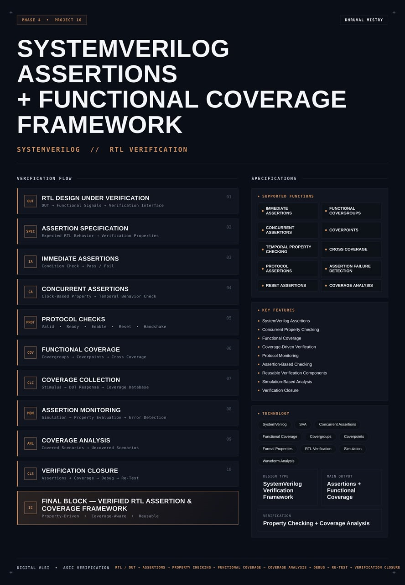
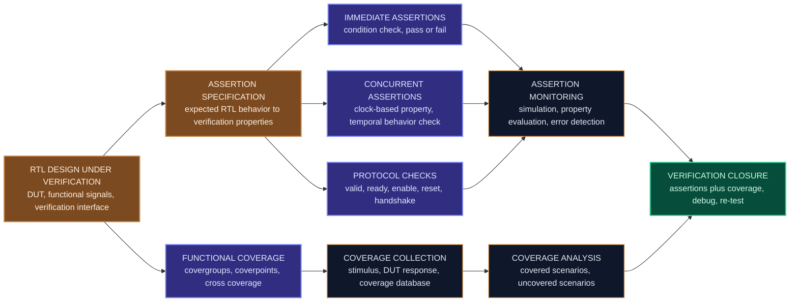
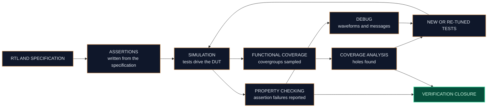
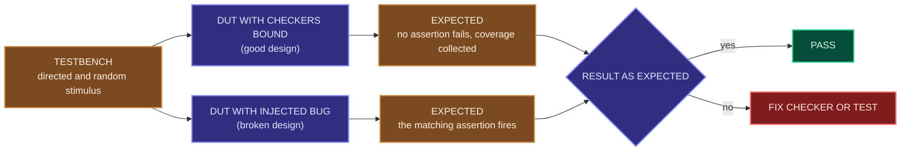
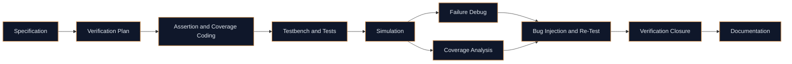

<div align="center">




<b>A reusable SystemVerilog verification framework that combines immediate and concurrent assertions, protocol and reset checks, and functional coverage with covergroups, coverpoints and cross coverage to measure how well an RTL design has been verified.</b>

<br/>


<br/>

[Overview](#overview) |
[At a Glance](#project-at-a-glance) |
[Background](#background-assertions-and-coverage) |
[Functions](#supported-functions) |
[Architecture](#architecture) |
[Functional Description](#functional-description) |
[Assertion Reference](#assertion-reference) |
[Coverage Reference](#coverage-reference) |
[Interface](#interface) |
[Verification Flow](#verification-flow) |
[Getting Started](#getting-started) |
[Verification Plan](#verification-plan) |
[Applications](#applications) |
[FAQ](#faq) |
[License](#license)

</div>

---

## Overview

This project implements a **SystemVerilog assertion and functional coverage framework** for **RTL verification**. It answers two questions that every verification effort has to answer: **is the design doing the right thing**, and **have we tested enough to know that**.

The first question is handled by **assertions**. An assertion is a statement about how the design must behave, written next to the design and checked automatically during every simulation. The framework contains **immediate assertions**, which check a condition at one moment, and **concurrent assertions**, which check **temporal behavior** over several clock cycles. They are grouped into **protocol checks** (valid, ready, enable, reset and handshake rules), **reset assertions** and general **property checking**, and any violation is reported as an **assertion failure** at the moment it happens.

The second question is handled by **functional coverage**. **Covergroups** collect the stimulus that the design actually saw and the responses it produced, using **coverpoints** for individual values and **cross coverage** for combinations. After the simulation, **coverage analysis** shows which scenarios were covered and which are still missing, so more tests can be written for the gaps.

Together the two form a loop: write assertions from the **specification**, run the **simulation**, read the **assertion failures** and the **coverage report**, **debug**, add tests and **re-run**, until the design reaches **verification closure**. The checkers are written as separate, **reusable** modules that attach to a design through a **verification interface** and a **bind**, so the design source itself is not changed.

<table>
<tr>
<td width="50%" valign="top">

#### Objectives
- Turn the RTL specification into checkable verification properties
- Write immediate assertions for condition checks
- Write concurrent assertions for clock-based temporal behavior
- Check protocol rules: valid, ready, enable, reset and handshake
- Collect functional coverage with covergroups, coverpoints and cross coverage
- Detect assertion failures during simulation and report them clearly
- Analyze covered and uncovered scenarios and close the gaps
- Package everything as reusable verification components

</td>
<td width="50%" valign="top">

#### Key Features
- SystemVerilog assertions
- Concurrent property checking
- Functional coverage
- Coverage-driven verification
- Protocol monitoring
- Assertion-based checking
- Reusable verification components
- Simulation-based analysis
- Verification closure

</td>
</tr>
</table>

---

## Project at a Glance

| Attribute | Detail |
|:--|:--|
| **Design type** | SystemVerilog verification framework |
| **Description language** | SystemVerilog (assertions, covergroups, testbench) |
| **Assertion kinds** | Immediate assertions and concurrent assertions (SVA) |
| **Checks** | Protocol checks, reset assertions, temporal property checking |
| **Coverage kinds** | Covergroups, coverpoints, cross coverage |
| **Attachment method** | Verification interface and `bind`, with no change to the design source |
| **Failure handling** | Assertion failure detection with a clear message at the failing time |
| **Coverage flow** | Collection, analysis, closure |
| **Main output** | Assertions and functional coverage |
| **Verification** | Property checking and coverage analysis |
| **Functions** | 10 (assertions, properties, protocol checks, reset checks, covergroups, coverpoints, cross, failure detection, analysis) |
| **Simulation** | Verilator |
| **Waveform analysis** | GTKWave |
| **License** | MIT |

---

## Background: Assertions and Coverage

A design that simulates without an obvious error is not necessarily a correct design. Two things can go wrong. A bug can occur and nobody notices, because nothing in the testbench was looking for it. Or the bug never occurs, because the stimulus never reached the situation that triggers it. Assertions address the first problem and functional coverage addresses the second.

#### Assertion-based verification

An **assertion** is an executable statement of intended behavior, such as "ready must be high within four cycles of valid" or "the FIFO must never be full and empty at the same time". It sits beside the design and watches the signals. As soon as the rule is broken, simulation reports a failure at that exact time and place. This shortens debugging a lot, because the failure is reported where the cause is, and not many cycles later where the wrong output finally shows up.

SystemVerilog defines two families:

| Family | Checked | Typical use |
|:--|:--|:--|
| **Immediate assertion** | At the moment a procedural statement runs, like an `if` | Checking a condition of the current values, such as one-hot, range or equality |
| **Concurrent assertion** | Continuously, on every clock edge, over a sequence of cycles | Checking temporal rules, such as handshakes, ordering, latency and reset behavior |

Concurrent assertions are written with **SVA** (SystemVerilog Assertions), a small language of **sequences** (patterns of events over time) and **properties** (rules built from sequences).

#### Functional coverage

**Code coverage** (lines, branches, toggles) tells how much of the design source has been executed. It cannot tell whether the **interesting scenarios** were exercised. **Functional coverage** is defined by the verification engineer from the specification: which values, which modes and which combinations must be seen before the design can be called verified. It is written with:

| Construct | Purpose |
|:--|:--|
| **Covergroup** | A container that is sampled on an event, such as a clock edge or a completed transfer |
| **Coverpoint** | One variable or expression to watch, divided into bins of interest |
| **Bins** | The values or ranges that must be hit, plus illegal and ignored values |
| **Cross** | Combinations of two or more coverpoints, for example direction crossed with length |
| **Transition bin** | A required sequence of values, such as moving from idle to busy to done |

#### Coverage-driven closure

Assertions and coverage work together. Assertions say whether the behavior was **right** when it happened. Coverage says whether the behavior **happened at all**. An assertion that never had a chance to trigger proves nothing, and coverage shows exactly that. The result is a loop of checking, measuring, finding holes, adding tests and checking again, until the plan is fully covered and no assertion fails. That point is called **verification closure**.

---

## Supported Functions

| Group | Function | Description |
|:--|:--|:--|
| **Assertions** | `IMMEDIATE ASSERTIONS` | Condition checks that pass or fail at the moment they run |
| **Assertions** | `CONCURRENT ASSERTIONS` | Clock-based properties checked on every clock edge |
| **Assertions** | `TEMPORAL PROPERTY CHECKING` | Rules over several cycles: ordering, latency, stability |
| **Assertions** | `PROTOCOL ASSERTIONS` | Valid, ready, enable and handshake rules of an interface |
| **Assertions** | `RESET ASSERTIONS` | Checks on outputs and state during and after reset |
| **Assertions** | `ASSERTION FAILURE DETECTION` | Reports a violated rule with the time and the property name |
| **Coverage** | `FUNCTIONAL COVERGROUPS` | Containers that collect coverage on a sampling event |
| **Coverage** | `COVERPOINTS` | Individual variables and expressions divided into bins |
| **Coverage** | `CROSS COVERAGE` | Combinations of coverpoints |
| **Coverage** | `COVERAGE ANALYSIS` | Shows which scenarios were covered and which are missing |

---

## Architecture

The framework is organized as the **RTL design under verification**, a **verification interface** that exposes the signals to watch, an **assertion** side (specification, immediate and concurrent assertions, protocol checks and monitoring), a **coverage** side (covergroups, collection and analysis) and a **closure** loop that feeds findings back into the tests.

#### Block diagram

```text
   +--------------------+       +-------------------------------+
   |     TESTBENCH      |       |   RTL DESIGN UNDER VERIFICATION|
   |  stimulus, clock,  |------>|   (DUT)                        |
   |  reset             |       |   functional signals           |
   +--------------------+       +---------------+---------------+
                                                |  signals to watch
                                                v
                                   +-----------------------------+
                                   |     VERIFICATION INTERFACE  |
                                   |     (attached with bind)    |
                                   +---------+-----------+-------+
                                             |           |
                       +---------------------+           +----------------------+
                       v                                                        v
        +-----------------------------+                       +------------------------------+
        |     ASSERTION SIDE          |                       |       COVERAGE SIDE          |
        |  assertion specification    |                       |  functional covergroups      |
        |  immediate assertions       |                       |  coverpoints                 |
        |  concurrent assertions      |                       |  cross coverage              |
        |  protocol checks            |                       |  coverage collection         |
        |  reset assertions           |                       |                              |
        +--------------+--------------+                       +---------------+--------------+
                       | property evaluation                                  | stimulus and DUT response
                       v                                                      v
        +-----------------------------+                       +------------------------------+
        |   ASSERTION MONITORING      |                       |      COVERAGE DATABASE       |
        |   error detection, log      |                       |      bins hit and missed     |
        +--------------+--------------+                       +---------------+--------------+
                       |                                                      |
                       +---------------------+--------------------------------+
                                             v
                               +-----------------------------+
                               |      COVERAGE ANALYSIS      |
                               |  covered vs uncovered       |
                               +--------------+--------------+
                                              v
                               +-----------------------------+
                               |    VERIFICATION CLOSURE     |
                               |  debug -> new tests -> re-run|
                               +-----------------------------+
```

#### Data flow



#### Block breakdown

| # | Block | Role |
|:-:|:--|:--|
| `01` | **RTL Design Under Verification** | The DUT, its functional signals and the verification interface |
| `02` | **Assertion Specification** | Expected RTL behavior turned into verification properties |
| `03` | **Immediate Assertions** | Condition check, pass or fail |
| `04` | **Concurrent Assertions** | Clock-based property, temporal behavior check |
| `05` | **Protocol Checks** | Valid, ready, enable, reset and handshake rules |
| `06` | **Functional Coverage** | Covergroups, coverpoints and cross coverage |
| `07` | **Coverage Collection** | Stimulus and DUT response recorded in the coverage database |
| `08` | **Assertion Monitoring** | Simulation, property evaluation and error detection |
| `09` | **Coverage Analysis** | Covered scenarios and uncovered scenarios |
| `10` | **Verification Closure** | Assertions and coverage, then debug and re-test |

> **Final block:** a property-driven, coverage-aware, reusable RTL assertion and coverage framework

---

## Functional Description

#### RTL design under verification
The design that is being checked. The framework only needs to see its signals, so the DUT is not modified. The signals of interest, such as clock, reset, valid, ready, enable and data, are collected in a **verification interface** that the checkers connect to.

#### Assertion specification
Verification starts from the specification. Every statement of expected behavior, such as "data stays stable while valid is high and ready is low", is rewritten as a property that can be checked automatically. This step also fixes names and descriptions, so a failure message points straight back to a line of the specification.

#### Immediate assertions
Check a condition at the moment a procedural statement runs, for example inside a clocked block. They are simple and good for conditions on the current values: a signal is one-hot, a counter is inside its range, two flags are not both set. The result is a pass or a fail for that moment.

#### Concurrent assertions
Check a property on every clock edge, using a sequence of events over time. They describe temporal behavior: "after a request, a grant comes within N cycles", "once valid is raised it stays high until ready". They are evaluated by the simulator continuously and need a clock and a reset condition to say when they are active.

#### Protocol checks
A group of concurrent assertions that together define the legal behavior of an interface: valid and ready handshakes, enable timing, stable data and control, and reset conditions. A protocol checker written once can be attached to every instance of that interface.

#### Reset assertions
Check what the design does during and after reset: outputs have their reset values, no response or valid output appears while reset is active, and the design is idle right after reset is released. Other assertions are switched off while reset is active with `disable iff`, so that they do not produce false failures.

#### Assertion monitoring
During simulation each property is evaluated every cycle. A violation is reported as an **assertion failure** with the property name, the message and the simulation time. A failure stops or marks the test, according to the setting of the testbench.

#### Functional coverage
Covergroups describe what must be seen. Each covergroup has a sampling event and a set of coverpoints and crosses. Typical coverpoints are the type of operation, the length or size of a transfer, the wait time, and the state of a flag. Crosses combine them, so that, for example, every operation is tested with every length.

#### Coverage collection
While the tests run, the covergroups are sampled and the hits are stored in a coverage database. Each bin counts how many times its value or sequence was observed.

#### Coverage analysis
After the run, the coverage report is read. Every bin that is not hit is a **hole**: a scenario that the tests never produced. Each hole is either filled by a new directed or random test, or excluded with a written reason if the scenario is not possible.

#### Verification closure
The framework is used in a loop: run, read assertion failures and coverage holes, debug, add tests, and run again. The design is ready for sign-off when no assertion fails, every assertion has been exercised, and the coverage targets of the plan are met.

---

## Assertion Reference

#### Assertion directives

| Directive | Purpose |
|:--|:--|
| `assert` | The property must hold. A violation is a failure |
| `assume` | The property is an assumption about the inputs, used by formal tools and by constrained stimulus |
| `cover` | Count how often the property or sequence happens. Used to prove the assertion is not vacuous |

#### Common SVA operators

| Operator | Meaning |
|:--|:--|
| `a \|-> b` | Overlapped implication: if `a` is true now, `b` must be true in the same cycle |
| `a \|=> b` | Non-overlapped implication: if `a` is true now, `b` must be true in the next cycle |
| `##n` | Wait exactly `n` clock cycles |
| `##[m:n]` | Wait between `m` and `n` clock cycles |
| `a [*n]` | `a` repeats for `n` consecutive cycles |
| `$rose(a)` / `$fell(a)` | `a` changed from 0 to 1 or from 1 to 0 since the previous clock edge |
| `$stable(a)` | `a` is unchanged since the previous clock edge |
| `$past(a, n)` | Value of `a` from `n` clock cycles ago |
| `disable iff (cond)` | Switch the property off while `cond` is true, for example during reset |

#### Immediate assertion (example)

```systemverilog
always_ff @(posedge clk) begin
  if (rst_n) begin
    a_not_full_and_empty: assert (!(full && empty))
      else $error("full and empty are both set");
  end
end
```

#### Concurrent assertions (examples)

```systemverilog
// Valid must stay high, with stable data, until ready arrives
property p_valid_hold;
  @(posedge clk) disable iff (!rst_n)
    (valid && !ready) |=> (valid && $stable(data));
endproperty
a_valid_hold: assert property (p_valid_hold)
  else $error("valid dropped or data changed before ready");

// Ready must come within MAX_WAIT cycles after valid
property p_ready_latency;
  @(posedge clk) disable iff (!rst_n)
    $rose(valid) |-> ##[0:MAX_WAIT] ready;
endproperty
a_ready_latency: assert property (p_ready_latency)
  else $error("ready did not arrive within MAX_WAIT cycles");

// No valid output while reset is active
a_reset_valid_low: assert property (@(posedge clk) !rst_n |-> !valid)
  else $error("valid is high during reset");

// Prove that the handshake property is not vacuous
c_handshake: cover property (@(posedge clk) disable iff (!rst_n) valid && ready);
```

The names, signals and the `MAX_WAIT` parameter above are illustrative. The actual checkers are in the files under `rtl/` and `tb/`.

#### Why every assertion needs a matching cover

A property of the form `a |-> b` passes **vacuously** whenever `a` never happens. The assertion then reports no failure, but it has also checked nothing. A `cover property` on the antecedent counts how many times the assertion was really tested. Any assertion whose cover count is zero is listed as a coverage hole.

#### Protocol checks of the framework

| Check | Rule |
|:--|:--|
| Valid hold | Once `valid` is high it stays high until `ready` |
| Data stable | Data and control do not change while `valid` is high and `ready` is low |
| Ready latency | `ready` arrives within the allowed number of cycles |
| Enable timing | The enable signal is only used in the allowed state |
| No transfer in reset | No valid output and no response while reset is active |
| Reset values | Outputs and state hold their reset values after reset |
| One response per request | The number of responses equals the number of requests |

---

## Coverage Reference

#### Covergroup structure (example)

```systemverilog
covergroup cg_transfer @(posedge clk iff rst_n);
  option.per_instance = 1;

  cp_dir : coverpoint is_write {
    bins write = {1};
    bins read  = {0};
  }

  cp_len : coverpoint burst_len {
    bins single = {1};
    bins small  = {[2:4]};
    bins large  = {[5:16]};
    illegal_bins zero = {0};
  }

  cp_wait : coverpoint wait_cycles {
    bins none = {0};
    bins some = {[1:3]};
    bins many = {[4:$]};
  }

  cp_state : coverpoint state {
    bins idle_to_busy = (IDLE => BUSY);
    bins busy_to_done = (BUSY => DONE);
  }

  x_dir_len : cross cp_dir, cp_len;
endgroup

cg_transfer cg = new();
```

The signals, bins and the state names above are illustrative.

#### Coverage constructs used

| Construct | Role in the framework |
|:--|:--|
| `covergroup` with a sampling event | Collects coverage on every clock edge, or on a completed transfer |
| `iff` guard | Samples only when the design is out of reset and the data is valid |
| `coverpoint` | Watches one signal or expression |
| Value and range bins | The values or ranges that must be hit |
| Transition bins | Required sequences of values |
| `illegal_bins` | Values that must never occur. A hit is reported as an error |
| `ignore_bins` | Values that are legal but not interesting and not counted |
| `cross` | Every combination of the crossed coverpoints |

#### Coverage metrics

| Metric | Meaning |
|:--|:--|
| Bin coverage | Bins hit divided by bins defined, as a percentage |
| Coverpoint coverage | Coverage of one coverpoint |
| Cross coverage | Coverage of the combinations of a cross |
| Covergroup coverage | Weighted combination of all coverpoints and crosses in the group |
| Assertion cover count | How often each assertion was actually exercised |

#### Reading a coverage report (illustrative)

| Coverpoint / cross | Bins | Hit | Coverage | Action |
|:--|:-:|:-:|:-:|:--|
| `cp_dir` | 2 | 2 | 100 percent | None |
| `cp_len` | 3 | 2 | 66.7 percent | Add a test with long transfers |
| `x_dir_len` | 6 | 4 | 66.7 percent | Add read with large and write with large |
| `cp_wait` | 3 | 3 | 100 percent | None |

The numbers show how a report is read. They are not results of this project. The real results are listed in the verification plan.

#### Code coverage and functional coverage together

| Kind | Measures | Limitation |
|:--|:--|:--|
| Code coverage | Which lines, branches and toggles were executed | Cannot tell whether important scenarios were tried |
| Functional coverage | Which specified scenarios were exercised | Only as good as the plan it was written from |

Both are collected. 100 percent code coverage with low functional coverage means that the tests ran the code but did not try the important cases. 100 percent functional coverage with holes in code coverage means that the plan missed some part of the design.

---

## Interface

#### Verification interface signals

| Signal | Direction (checker) | Description |
|:--|:-:|:--|
| Clock | Input | Clock for the assertions and the sampling event |
| Reset | Input | Reset of the design, used in `disable iff` and in reset checks |
| Valid | Input | Valid signal of the monitored interface |
| Ready | Input | Ready signal of the monitored interface |
| Enable | Input | Enable signal of the monitored design, where present |
| Data and control | Input | Payload and control values to be stored and checked for stability |
| State and flags | Input | Internal state or flag values used by assertions and coverpoints |

The checker only observes. It drives nothing in the design.

#### Attaching the framework with bind

```systemverilog
bind dut_example proto_assertions #(
    .DATA_WIDTH (8),
    .MAX_WAIT   (4)
) u_proto_checker (
    .clk   (clk),
    .rst_n (rst_n),
    .valid (valid),
    .ready (ready),
    .data  (data)
);
```

`bind` instantiates the checker inside the design hierarchy without editing the design file. The checker sees the design's signals by name, and removing it is a one-line change.

#### Parameters and configuration

| Item | Value |
|:--|:-:|
| Data width of the monitored interface | `TBD` |
| Maximum ready latency (`MAX_WAIT`) | `TBD` |
| Enable assertions switch | `TBD` |
| Enable coverage switch | `TBD` |
| Reset polarity | `TBD` |
| Coverage target per covergroup | `TBD` |
| Action on assertion failure (stop or continue) | `TBD` |

---

## Verification Flow

The framework follows a loop. RTL and the specification go in, assertions and coverage are used during simulation, and the findings feed the next round of tests until the plan is closed.



1. **Specify.** Write the properties and the coverage items from the specification.
2. **Simulate.** Run the tests with assertions and covergroups enabled.
3. **Check.** Read the assertion failures. Each one is either a design bug or a wrong assertion, and both need fixing.
4. **Measure.** Read the coverage report and the assertion cover counts.
5. **Close the holes.** Add directed or random tests for each missing bin, or exclude it with a written reason.
6. **Repeat.** Re-run until no assertion fails and the coverage targets are met.

---

## Repository Structure

```text
systemverilog-assertions-functional-coverage-framework/
├── rtl/
│   └── dut_example.sv              # Example design used to demonstrate the framework
├── tb/
│   ├── verif_if.sv                 # Verification interface
│   ├── immediate_assertions.sv     # Immediate assertion checks
│   ├── proto_assertions.sv         # Concurrent protocol assertions
│   ├── reset_assertions.sv         # Reset assertions
│   ├── functional_coverage.sv      # Covergroups, coverpoints and cross coverage
│   ├── bind_checkers.sv            # Bind of the checkers to the design
│   └── framework_tb.sv             # Testbench with directed and random tests
├── sim/
│   ├── waves.vcd                   # Generated waveform dump
│   └── coverage_report/            # Coverage report output
├── docs/
│   └── verification_plan.md        # Assertion and coverage plan
├── LICENSE
└── README.md
```

---

## Technology Stack

| Tool | Role in this project |
|:--|:--|
|  | Design, testbench, assertions and covergroups |
|  | Immediate and concurrent assertions |
|  | Compiles and simulates the design and collects coverage |
|  | Views waveforms around assertion failures |

---

## Getting Started

#### Prerequisites

| Tool | Purpose | Version |
|:--|:--|:--|
| Verilator | Simulation, assertions and coverage | 5.050 or later for covergroups, 5.054 or later recommended |
| GTKWave | Waveform viewer | Any recent |

Functional coverage with covergroups arrived in Verilator in release 5.050, and support for more constructs (cross bins, wildcard bins, coverage queries) was added in the releases after it. A package from a Linux distribution can be older than that, in which case Verilator can be built from its source repository.

```bash
# Ubuntu / Debian (check the installed version with: verilator --version)
sudo apt update
sudo apt install verilator gtkwave
```

#### 1. Clone

```bash
git clone https://github.com/dhruvalmistry2007/systemverilog-assertions-functional-coverage-framework.git
cd systemverilog-assertions-functional-coverage-framework
```

#### 2. Simulate with assertions and coverage

```bash
verilator --binary --timing --trace --assert --coverage -Wall --top-module framework_tb \
  rtl/dut_example.sv tb/verif_if.sv tb/immediate_assertions.sv tb/proto_assertions.sv \
  tb/reset_assertions.sv tb/functional_coverage.sv tb/bind_checkers.sv tb/framework_tb.sv
./obj_dir/Vframework_tb
```

`--assert` turns on the assertions and `--coverage` turns on coverage collection.

#### 3. Read the coverage report

```bash
verilator_coverage --annotate sim/coverage_report coverage.dat
```

The testbench also prints the coverage of every covergroup at the end of the run.

#### 4. View waveforms around a failure

```bash
gtkwave sim/waves.vcd
```

Use the failure time printed in the assertion message to jump to the failing cycle.

---

## Verification Plan

The framework is itself verified, because a checker that is wrong is worse than no checker. Each assertion is tested on a good design, on a deliberately broken design, and with a cover that proves it is exercised.



#### Test plan

| Area | Scenario | Expected behavior |
|:--|:--|:--|
| Clean run | Run all tests on the unmodified design | No assertion fails |
| Reset | Apply reset at start and in the middle of a run | Reset assertions hold, and other assertions stay quiet while reset is active |
| Valid hold | Inject a bug that drops `valid` before `ready` | The valid hold assertion fires |
| Data stability | Inject a bug that changes data while waiting | The data stability assertion fires |
| Ready latency | Inject a bug that delays `ready` beyond `MAX_WAIT` | The latency assertion fires |
| Output in reset | Inject a bug that drives an output during reset | The reset assertion fires |
| Condition check | Inject a bug that sets two exclusive flags | The immediate assertion fires |
| Missing response | Inject a bug that loses a response | The response count assertion fires |
| Assertion cover | Run the normal tests | Every assertion has a cover count above zero |
| Directed coverage | Tests aimed at each coverage bin | The targeted bins are hit |
| Random coverage | Constrained random stimulus over a long run | Coverage rises without assertion failures |
| Cross coverage | Directed tests for the missing combinations | All reachable cross bins are hit |
| Illegal bins | Drive a value that is declared illegal | The illegal bin hit is reported |
| Hole analysis | Compare the report with the plan | Every missing bin is filled or excluded with a reason |
| Re-run | Run the full regression after any change | Results are identical or improved |

#### Assertion and coverage plan (illustrative)

| Specification item | Assertion | Cover item |
|:--|:--|:--|
| Valid stays until ready | `a_valid_hold` | `c_handshake` |
| Ready within N cycles | `a_ready_latency` | Wait cycle bins in `cp_wait` |
| No output in reset | `a_reset_valid_low` | Reset applied in each state |
| Flags are exclusive | `a_not_full_and_empty` | Full and empty each seen |
| Every request answered | Response count assertion | Direction crossed with length |

#### Results

| Metric | Value |
|:--|:-:|
| Assertions defined | `TBD` |
| Assertions that pass in the clean run | `TBD` |
| Injected bugs caught | `TBD` |
| Assertions with cover count above zero | `TBD` |
| Covergroup coverage | `TBD` |
| Cross coverage | `TBD` |
| Code coverage (line / toggle) | `TBD` |
| Open coverage holes with reason | `TBD` |

#### Waveform analysis checklist

| Signal | What to confirm |
|:--|:--|
| Clock and reset | Assertions are enabled only after reset is released |
| Valid and ready | Handshake timing matches the protocol rules |
| Data | Stable while valid is high and ready is low |
| Assertion failure time | The waveform at that time shows the cause of the failure |
| Coverage sampling event | Fires only when the design is active |
| Flags and state | Match the values expected by the coverpoints |

---

## Synthesis Considerations

Assertions, covergroups and testbench code are **verification code**. They are not meant to be synthesized, and synthesis tools ignore or reject them. The design that they check is synthesized as usual.

| Aspect | Approach |
|:--|:--|
| **Separation** | Checkers live in separate files and are attached with `bind`, so the design file stays clean |
| **Synthesis input** | Only the design files go to the synthesis tool. Checker and testbench files are left out |
| **Simulation only** | Assertions and covergroups are used for simulation, and for formal tools that support the property subset |
| **Removal** | Removing a checker means removing its `bind` line, with no change to the design |

---

## Design Considerations

| Aspect | Approach |
|:--|:--|
| **Reusability** | Each checker is a parameterized module that attaches to any design with the same interface |
| **Non-intrusive** | Checkers only observe signals and never drive the design |
| **Reset handling** | `disable iff` keeps assertions quiet during reset, and separate assertions check reset itself |
| **Vacuity** | Every assertion has a matching cover to prove that it was exercised |
| **Failure reporting** | Messages include the property name and the simulation time |
| **Coverage planning** | Bins come from the specification, with illegal and ignored bins stated explicitly |
| **Sampling** | Covergroups sample only when the design is active, using an `iff` guard |
| **Simulator support** | Standard SystemVerilog syntax, tested with Verilator and portable to other simulators |
| **Verification of the checkers** | Bug injection confirms that every assertion can actually fail |

#### Current limitations
- Simulation-based only, with no formal proof of the properties
- Stimulus is directed and constrained random without a full UVM environment
- Support for some SVA and covergroup constructs depends on the simulator version
- Coverage targets are set by the plan and do not prove that the plan itself is complete

---

## Applications

- Protocol checking for valid and ready interfaces and for bus slaves
- Verifying FIFOs, FSMs, arbiters, counters and register blocks
- Reset and initialization checking for any RTL block
- Coverage-driven regressions for block-level and IP-level verification
- Reusable checker library that attaches to designs with `bind`
- Reference for writing verification plans and measuring closure
- Teaching design for assertion-based and coverage-driven verification

---

## Customization

#### Add a new assertion

1. Write the rule from the specification in words, with a name.
2. Choose the form. Use an immediate assertion for a condition of the current values and a concurrent assertion for behavior over time.
3. Add `disable iff` for reset where the rule should not apply in reset.
4. Add a `cover property` for the antecedent.
5. Add a test that triggers it and a bug injection that makes it fail.
6. Add it to the assertion and coverage plan.

#### Add a new coverpoint or cross

1. Decide which scenario the specification requires to be seen.
2. Add the coverpoint with its bins, and mark illegal and ignored values explicitly.
3. Add a cross if combinations matter.
4. Add a test that is aimed at the new bins.
5. Re-run and update the report and the plan.

#### Attach the framework to another design

1. Create a verification interface with the signals of the new design.
2. Set the parameters (data width, `MAX_WAIT`).
3. Add a `bind` line for the new design.
4. Run the clean regression, then the bug injection tests, before trusting the results.

---

## Troubleshooting

| Problem | Likely cause | Fix |
|:--|:--|:--|
| `--binary` option not recognized | Verilator version is older than 5.x | Upgrade Verilator to 5.x or later |
| Covergroup is rejected or ignored | Verilator is older than 5.050 | Upgrade Verilator, or build it from source |
| A coverage construct is unsupported | The construct was added in a later Verilator release | Upgrade Verilator or use a simpler form of the bin |
| Assertions never fire | Assertions are not enabled in the simulator | Build with `--assert` |
| Coverage report is empty | Coverage is not enabled | Build with `--coverage` and run the simulation before reading the data |
| Coverage stays at 0 percent | Sampling event never fires or the `iff` guard is always false | Check the clock, the reset polarity and the guard |
| Failure at time 0 or during reset | Missing `disable iff` on a concurrent assertion | Add `disable iff (!rst_n)` |
| Assertion never fails, even with a bug | Vacuous pass, because the antecedent never happens | Check the cover count and add a test that reaches the antecedent |
| `$past` gives unexpected values in the first cycles | History is not yet filled | Guard the property so it starts after enough cycles |
| Bind does not find the signals | Names in the bind do not match the design | Use the exact signal names of the design module |
| Waveform does not show the failure cause | Tracing is not enabled | Build with `--trace` and make sure the testbench calls `$dumpfile` and `$dumpvars` |

---

## FAQ

**What is the difference between an immediate and a concurrent assertion?**
An immediate assertion checks a condition at the moment the statement runs, like an `if`. A concurrent assertion is evaluated on every clock edge and can describe behavior that spans several cycles. Immediate assertions suit current-value checks, and concurrent assertions suit protocols and timing rules.

**What is a vacuous pass?**
An implication passes automatically when its left side never happens. The assertion then reports no failure, but it has not checked anything. A `cover property` on the left side shows whether the assertion was ever really tested.

**What is the difference between `assert`, `assume` and `cover`?**
`assert` states a rule that the design must obey. `assume` states a rule that the inputs obey, which formal tools and constrained stimulus use. `cover` counts how often a situation happens.

**What is the difference between code coverage and functional coverage?**
Code coverage measures how much of the source code ran. Functional coverage measures how many of the specified scenarios were tried. Code coverage is automatic, and functional coverage has to be defined from the specification.

**Does 100 percent coverage mean the design has no bugs?**
No. It means that every scenario in the plan was exercised and no assertion failed. A scenario that is missing from the plan is not measured, so the plan itself has to be reviewed too.

**Why use `bind`?**
`bind` attaches a checker to a design without editing the design file. The design stays clean, the checker can be reused on other designs, and it can be removed without touching the design.

**Why are the checkers not synthesized?**
Assertions and covergroups only observe and report. They have no hardware function, so they stay in the verification files and are left out of the synthesis input.

**Why Verilator and GTKWave?**
They are free, open-source tools, so the whole framework can be reproduced without licenses. The code uses standard SystemVerilog and can also be run on other simulators.

---

## Learning Outcomes

- Turning a specification into checkable properties
- Writing immediate and concurrent SystemVerilog assertions
- Using SVA operators for temporal behavior and protocol rules
- Handling reset with `disable iff` and reset assertions
- Writing covergroups with coverpoints, bins and cross coverage
- Reading a coverage report and closing holes
- Understanding vacuity and proving assertions with cover
- Attaching reusable checkers to a design with `bind`
- Verifying the checkers themselves with bug injection

---

## Design Flow



<div align="center">

`RTL / DUT` | `ASSERTIONS` | `PROPERTY CHECKING` | `FUNCTIONAL COVERAGE` | `COVERAGE ANALYSIS` | `DEBUG` | `RE-TEST` | `VERIFICATION CLOSURE`

</div>

---

## Future Work

- Add formal verification of the properties with a formal tool for the supported subset
- Add constrained-random stimulus with randomized transactions
- Add a coverage-driven test generator that targets open holes
- Add a UVM-style environment around the checkers
- Add ready-made protocol checkers for common buses such as APB and AXI4-Lite
- Add a checker for FIFO and arbiter properties
- Add an automatic coverage summary and a pass or fail gate for regressions
- Add a regression script that merges coverage from many runs

---

## Contributing

Suggestions and improvements are welcome. Open an issue to discuss a change, or submit a pull request with a clear description of what it does and the simulation results that support it.

---

## References

- [Verilator](https://www.veripool.org/verilator/): open-source SystemVerilog simulator
- [GTKWave](https://gtkwave.sourceforge.net/): waveform viewer
- [SymbiYosys](https://yosyshq.readthedocs.io/projects/sby/): open-source formal verification flow
- IEEE Std 1800: SystemVerilog language standard, including assertions and functional coverage

---

## License

This project is licensed under the **MIT License**. See the [LICENSE](LICENSE) file for details.

---

## Author

<div align="center">

**Dhruval Mistry**

[](https://github.com/dhruvalmistry2007)

<br/>


</div>
